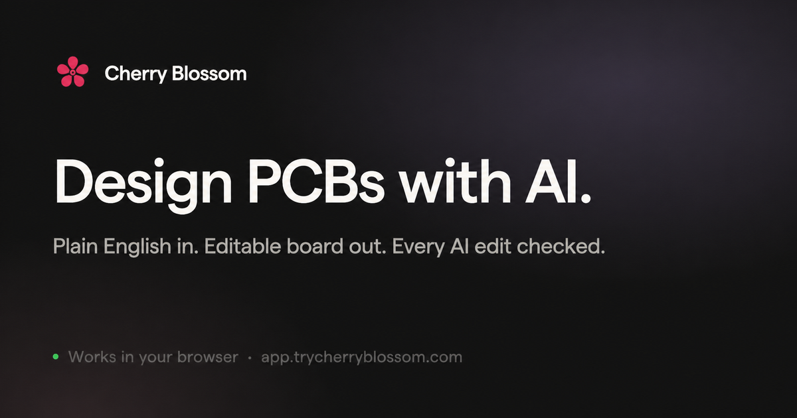

<div align="center">

<a href="https://app.trycherryblossom.com">
  
</a>

### From Prompt to PCB.

Cherry Blossom is an AI-first PCB design tool that pairs a Figma-style
interface with the depth hardware engineers actually need. Describe a circuit
in plain English, drag components onto the board, or do both — it runs in your
browser, with no install and no account.

[**Open the app →**](https://app.trycherryblossom.com) &nbsp;·&nbsp; [trycherryblossom.com](https://www.trycherryblossom.com)


</div>

> [!WARNING]
> **Early stage.** The schematic and PCB editors work end to end, but expect
> rough edges and breaking changes.

---

## Run it locally

Requires **Node 24** (see [`.nvmrc`](.nvmrc)).

```bash
npm install
npm run dev          # http://localhost:5173
```

No environment variables, no API keys, no services to provision — a fresh clone
runs as-is. [AGENTS.md](AGENTS.md) has the architecture, the conventions, and
the sharp edges if you're digging in.

## Contributions

**We're not looking for pull requests right now.** The project is early enough
that the architecture is still moving under our feet, and a PR you spend real
time on may sit unreviewed or get closed because it collides with something
we're already rewriting. We'd rather say that up front than waste your evening.

Bug reports are genuinely useful — open an issue. Found a security problem?
Please don't file it publicly; contact a maintainer directly.

## License

[AGPL-3.0-or-later](LICENSE). Use it commercially, modify it, redistribute it,
build a business on it. The one obligation: if you distribute a modified
version, or run one as a network service others use, those users get the
complete source of your version under this same license.

Designing boards with the editor — including boards you sell — carries no
obligation at all. This governs the editor's source, not your circuits.

Third-party components keep their own licenses; see
[THIRD-PARTY-NOTICES.md](THIRD-PARTY-NOTICES.md). "Cherry Blossom" and the
cherry blossom logo are trademarks and are not licensed — please rename and
re-brand forks.

<div align="center">
<br />
Made with 🌸 for the hardware community
</div>
