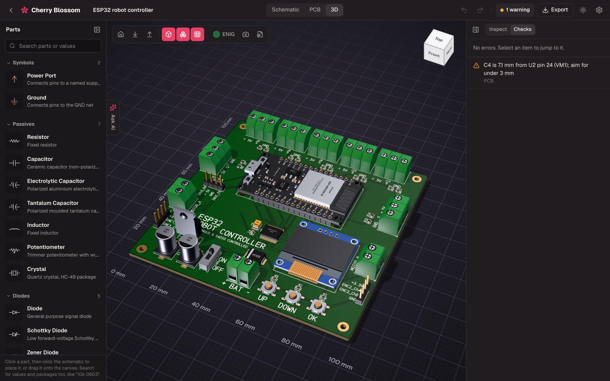
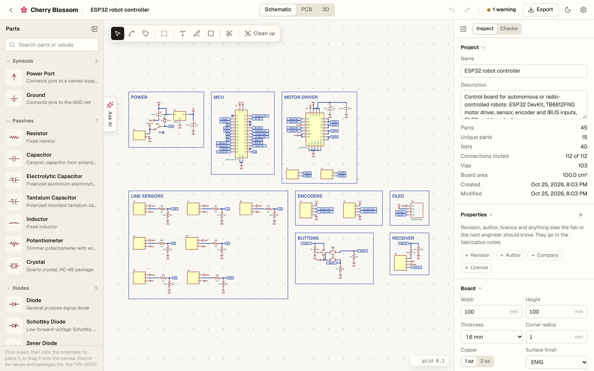
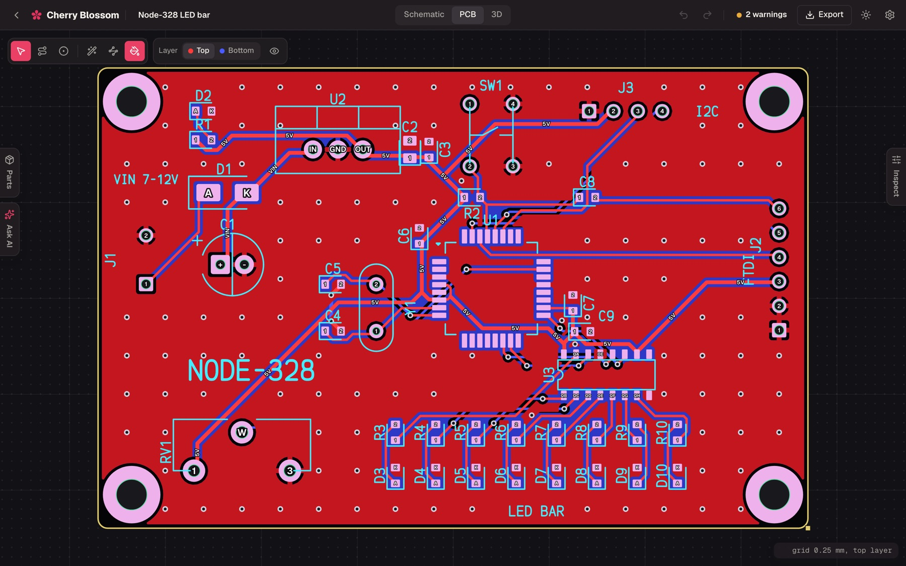
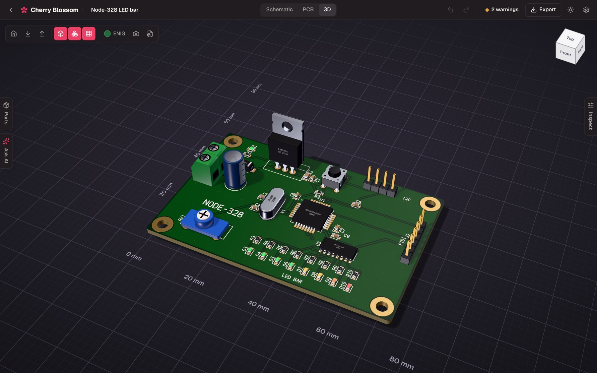
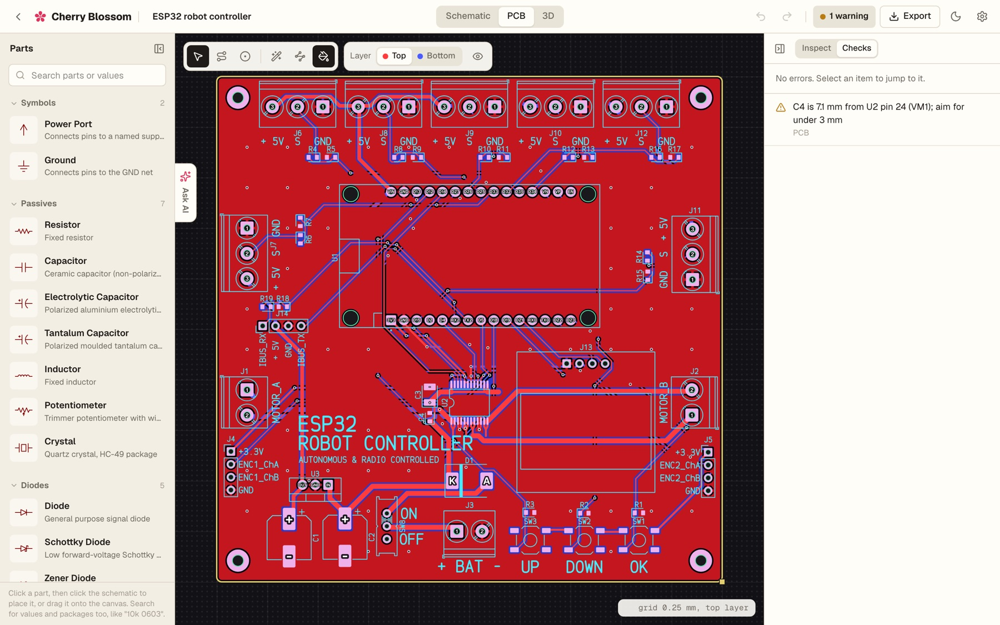
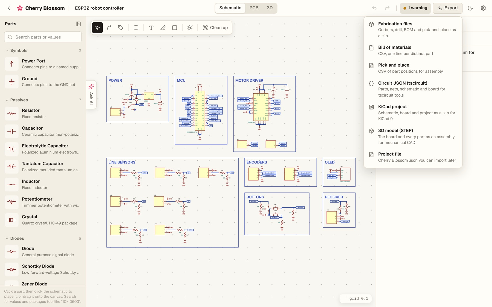
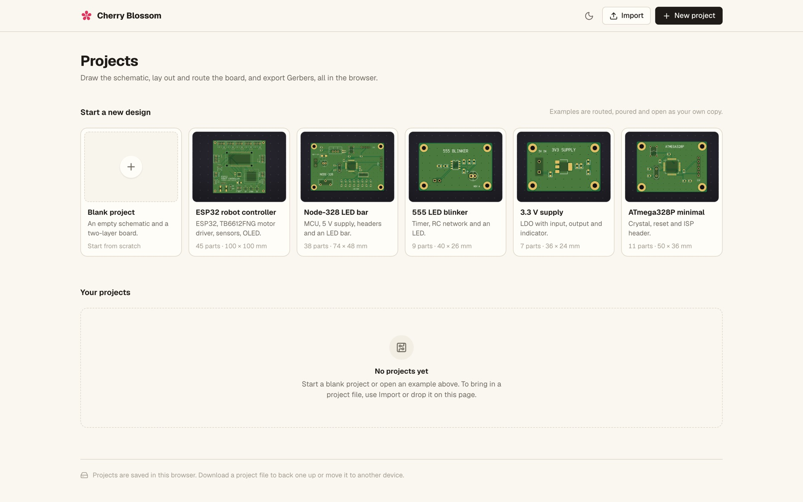

<p align="center">
  <a href="https://www.trycherryblossom.com">
    
  </a>
</p>

<h1 align="center">Cherry Blossom</h1>

<p align="center">
  <b>A schematic and PCB editor that runs in your browser.</b><br>
  Draw the schematic, lay out and route the board, check it, see it in 3D,<br>
  and export Gerbers, KiCad and STEP. Open source, no install, no account.
</p>

<p align="center">
  
  
  
  
  
  
</p>

<p align="center">
  <a href="https://www.trycherryblossom.com/app"><b>Open the hosted app</b></a> ·
  <a href="https://www.trycherryblossom.com">trycherryblossom.com</a> ·
  <a href="https://github.com/cherryblossomhq/webapp/issues">Report a bug</a>
</p>

<br>

<p align="center">
  
  <br>
  <sub>The ESP32 robot controller example in the 3D view: 45 parts, routed and poured, with one decoupling warning in Checks.</sub>
</p>

> [!NOTE]
> **This is the editor behind [trycherryblossom.com](https://www.trycherryblossom.com).**
> The hosted app adds accounts, projects in the cloud, supplier part data and
> **Sakura**, an AI copilot that builds circuits from a sentence. Everything in
> this repository — the whole editor, by hand — runs locally with no backend.

<p align="center">
  <a href="#features">Features</a> ·
  <a href="#everything-in-the-box">Everything in the box</a> ·
  <a href="#sakura-the-ai-copilot">Sakura</a> ·
  <a href="#under-the-hood">Under the hood</a> ·
  <a href="#get-started">Get started</a> ·
  <a href="#contributing">Contributing</a> ·
  <a href="#license-and-credits">License</a>
</p>

<br>

<table>
  <tr>
    <td width="25%" valign="top">
      <h3>📐 Drawn like a sheet</h3>
      KiCad's proportions on a 50 mil grid, named blocks, net labels and power ports. Tidy redraws a messy sheet as an engineering drawing in one keystroke, without changing what's connected.
    </td>
    <td width="25%" valign="top">
      <h3>⚡ Routed in seconds</h3>
      Automatic placement that knows a regulator's power stage, a two-layer autorouter with per-net widths and fine-pitch escapes, and copper pours with thermals and stitching vias.
    </td>
    <td width="25%" valign="top">
      <h3>✅ Checked before you order</h3>
      Clearance, shorts, unrouted nets, courtyards, annular rings and the rest of the design rules, plus electrical checks that catch an LED with no resistor.
    </td>
    <td width="25%" valign="top">
      <h3>📦 Ready for the fab</h3>
      Gerbers, Excellon drill, BOM and pick-and-place in one zip, with fabrication notes. Or take the board elsewhere: KiCad, Circuit JSON and STEP.
    </td>
  </tr>
</table>

<br>

## Features

Every screenshot here is the editor as it runs from this repository, on its shipped examples.

<table>
  <tr>
    <td width="50%" valign="top">
      
      <br>
      <sub>A schematic grouped into blocks, on the classic cream EDA sheet.</sub>
      <h3>A schematic that reads like one</h3>
      Orthogonal wires, net labels that sit side by side on neighbouring pins, junction dots, and parts that rubber-band their wires when they move. Group parts into named blocks (<code>⌘G</code>) and the frames follow them.
      <br><br>
      <b>Tidy</b> (<code>T</code>) lays the sheet out again by signal flow: supply in, regulation, the controller, what it talks to. <b>Clean up</b> groups loose parts into blocks by how they're wired first. Both are one undo step, and both are checked pin for pin against the netlist.
    </td>
    <td width="50%" valign="top">
      
      <br>
      <sub>Two layers, routed and poured, with designators placed clear of the pads.</sub>
      <h3>Layout that does the tedious part</h3>
      Auto-placement puts each decoupling capacitor beside the pin it serves, and a regulator's capacitors, inductor and feedback divider at its pins. The autorouter runs A* on two layers with vias, net-aware clearances and per-net trace widths, and keeps the copper you routed by hand.
      <br><br>
      Interactive routing with 45° bends and vias, bottom-side parts, mounting holes, silkscreen text and board-wide pours with thermal spokes and stitching vias.
    </td>
  </tr>
  <tr>
    <td width="50%" valign="top">
      
      <br>
      <sub>Every library package has a model, so the 3D view is there the moment it opens.</sub>
      <h3>See it before it's made</h3>
      Procedural models for every library package, from chip resistors with value codes to ESP32 DevKits on their headers, on a board with glossy mask, plated holes and your choice of finish, mask and silkscreen colour.
      <br><br>
      Drop in a real model (STEP, OBJ, WRL, STL or GLB) for any part. STEP files are read by OpenCascade in a Web Worker, so nothing leaves your machine.
    </td>
    <td width="50%" valign="top">
      
      <br>
      <sub>A decoupling capacitor too far from the pin it serves, found and pointed at.</sub>
      <h3>Checks that know electronics</h3>
      Design rule checks for trace width, clearance, drill, annular ring, hole to hole, copper to edge and vias in pads, with fab capability classes that set a fab's limits in one step.
      <br><br>
      Electrical checks too: an LED with no series resistor, a two-pin part shorted to itself, a label no other pin has. Click one to select the culprit, or ignore a false alarm for good.
    </td>
  </tr>
  <tr>
    <td width="50%" valign="top">
      
      <br>
      <sub>Everything a fab, an assembler or another tool needs, from one menu.</sub>
      <h3>Take it anywhere</h3>
      RS-274X Gerbers with pours, mask and paste, Excellon drill with slots, a BOM, pick-and-place and fabrication notes, zipped. A KiCad 9 project with the rules and net classes carried over, Circuit JSON for tscircuit, and the whole board as a STEP assembly for mechanical CAD.
    </td>
    <td width="50%" valign="top">
      
      <br>
      <sub>Five routed examples to start from, each opening as your own copy.</sub>
      <h3>Yours, in your browser</h3>
      Projects save as you work, in your browser, and download as a single versioned file you can open anywhere. Older files are migrated when they open, and a file from a newer version is refused rather than damaged.
      <br><br>
      Light and dark themes, shortcuts for every tool, and undo for every change.
    </td>
  </tr>
</table>

<br>

## Everything in the box

<table>
  <tr>
    <td width="33%" valign="top">
      <h4>🧰 93 built-in parts</h4>
      Resistors, capacitors (ceramic, electrolytic, tantalum), inductors, trimmers, crystals, diodes, LEDs, BJTs and MOSFETs · NE555, LM358, ATmega328P, ATtiny85, 74HC595, CH340, ULN2003A, PC817, TB6612FNG, LM7805, AMS1117, AP2112K, WS2812B · Arduino Nano, Raspberry Pi Pico, ESP32 modules and DevKits, Wemos D1 Mini, XIAO ESP32-C3, an I2C OLED · headers, IC sockets, screw and pluggable terminals, JST PH/XH, Qwiic, USB-C, micro-USB, barrel jack, microSD · switches, a relay, a buzzer.
      <br><br>
      Search understands values and packages: <code>10k 0603</code> places a 10k 0603 resistor.
    </td>
    <td width="33%" valign="top">
      <h4>✏️ Schematic</h4>
      Wires · net labels · power and ground ports · junctions · no-connect flags · blocks · text, lines, arrows, polygons and rectangles for titles and notes · copy, paste and duplicate · Tidy · Clean up · rotate, flip and drag with nets kept intact.
      <h4>🟥 PCB</h4>
      Auto-place · re-pack · autoroute · interactive routing · vias · per-net widths · copper pours · thermal spokes · stitching vias · locked parts and copper · board outline, corner radius, mounting holes · stackup, copper weight, finish, mask and silkscreen colours · design rules in mm or mil.
    </td>
    <td width="33%" valign="top">
      <h4>📤 Exports</h4>
      Gerber RS-274X · Excellon drill · BOM CSV · pick-and-place CSV · fabrication notes · KiCad 9 project · Circuit JSON · STEP AP214 assembly · PNG from the 3D view · the project file.
      <h4>⌨️ Shortcuts</h4>
      Schematic: <code>W</code> wire · <code>L</code> label · <code>B</code> block · <code>R</code> rotate · <code>T</code> tidy · <code>⌘G</code> group.<br>
      PCB: <code>X</code> route · <code>V</code> via · <code>L</code> layer · <code>F</code> flip.<br>
      Both: <code>⌘Z</code> undo · <code>[</code> <code>]</code> panels. The full list is in <a href="AGENTS.md#shortcuts">AGENTS.md</a>.
    </td>
  </tr>
</table>

<br>

## Sakura, the AI copilot

The hosted app at [trycherryblossom.com](https://www.trycherryblossom.com/app) adds **Sakura**:
describe a circuit or a change, and it picks parts, builds the ones the library
doesn't have from supplier data, places and wires them, groups and annotates the
sheet, lays out and routes the board, runs the checks, and looks at its own work
before it reports. Every step is an ordinary edit you can undo.

Sakura's tools and agent loop are in this repository (`src/ai`), and run in the
browser; the models and the supplier data they call are the hosted app's. A local
build has no session, so its Sakura panel offers to sign in at the hosted app
instead of calling anything.

## Under the hood

- **Its own document model.** A typed ECAD project edited by pure functions, with
  no compile step between what you draw and what's on screen. Connectivity, checks
  and exports all read the same model.
- **Nets are sacred.** Every move, turn, paste, drag and Tidy is checked against the
  netlist; an edit that would short two nets or cut a pin loose is refused, with
  a sentence saying why, and changes nothing.
- **Fast where it matters.** Spatial indexes, memoised analysis,
  Tidy and STEP reading in Web Workers, and the 3D view and KiCad converter loaded
  only when you ask for them.
- **A real file format.** Versioned, migrated on read, and tolerant of fields it
  doesn't know, which survive a save.
- **Tested hard.** More than 2,200 unit tests, including fuzzers that throw random
  edits at random sheets, round trips through Circuit JSON, and STEP and KiCad
  exports read back and checked; plus a Playwright suite that
  drives the editor in a real browser.

## Get started

Requires **Node 24** (see [`.nvmrc`](.nvmrc)).

```bash
git clone https://github.com/cherryblossomhq/webapp
cd webapp
npm install
npm run dev          # http://localhost:5173
```

No environment variables, no API keys, no services to provision.

```bash
npm run check        # typecheck, unit tests and a production build
npm run test:e2e     # the browser suite (run npm run test:e2e:install once first)
npm run build        # a static site in dist/
```

The build is a static single-page app: host `dist/` anywhere, with every path
falling back to `index.html` so a link to a project (`/p/<id>`) opens it.

New contributors and AI agents: start with [`AGENTS.md`](AGENTS.md). It covers the
architecture, the file format, how Tidy and the router work, and the sharp edges.

> [!IMPORTANT]
> **Early stage.** The schematic and PCB editors work end to end and the examples
> go all the way to Gerbers, but expect rough edges and breaking changes. Boards
> are two layers for now; multi-layer boards, hierarchical sheets, simulation and
> real-time collaboration are not here yet. Please file issues with the steps,
> your browser, and a project file if you can share one.

## Contributing

**We're not looking for pull requests right now.** The project is early enough
that the architecture is still moving under our feet, and a PR you spend real
time on may sit unreviewed or get closed because it collides with something
we're already rewriting. We'd rather say that up front than waste your evening.

Bug reports are genuinely useful: [open an issue](https://github.com/cherryblossomhq/webapp/issues).
Found a security problem? Please don't file it publicly; contact a maintainer directly.

---

## License and credits

[AGPL-3.0-or-later](LICENSE). Use it commercially, modify it, redistribute it,
build a business on it. The one obligation: if you distribute a modified
version, or run one as a network service others use, those users get the
complete source of your version under this same license.

Designing boards with the editor — including boards you sell — carries no
obligation at all. This governs the editor's source, not your circuits.

Third-party components keep their own licenses; see
[THIRD-PARTY-NOTICES.md](THIRD-PARTY-NOTICES.md). "Cherry Blossom" and the
cherry blossom logo are trademarks and are not licensed — please rename and
re-brand forks.

<sub>KiCad, Altium and other product names are trademarks of their respective owners. Cherry Blossom is an independent project, not affiliated with or endorsed by them; the names are used only to describe compatible workflows and file formats.</sub>

<p align="center">
  <a href="https://www.trycherryblossom.com"></a><br>
  <sub>Made with 🌸 for the hardware community.</sub>
</p>

## Star history

[](https://www.star-history.com/#cherryblossomhq/webapp&Date)
