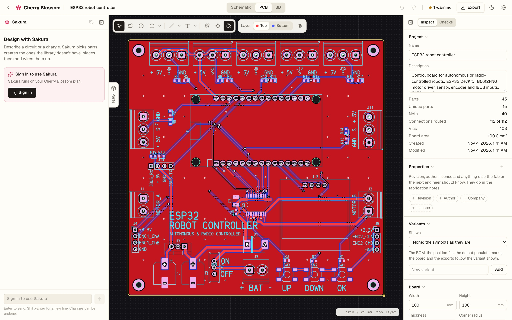
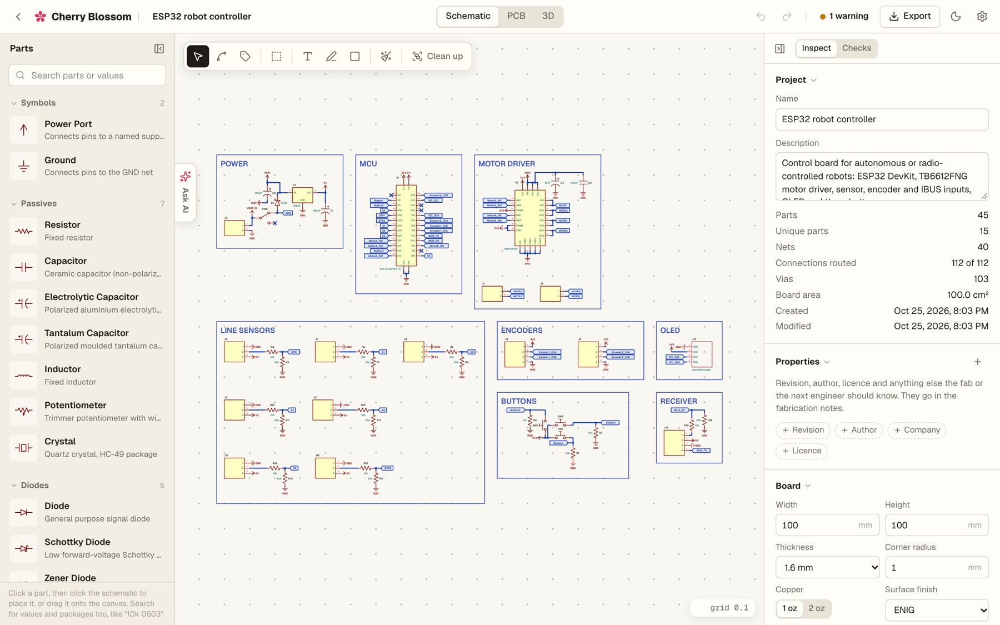
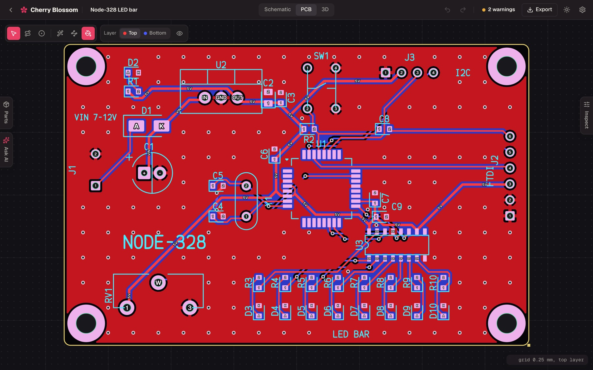
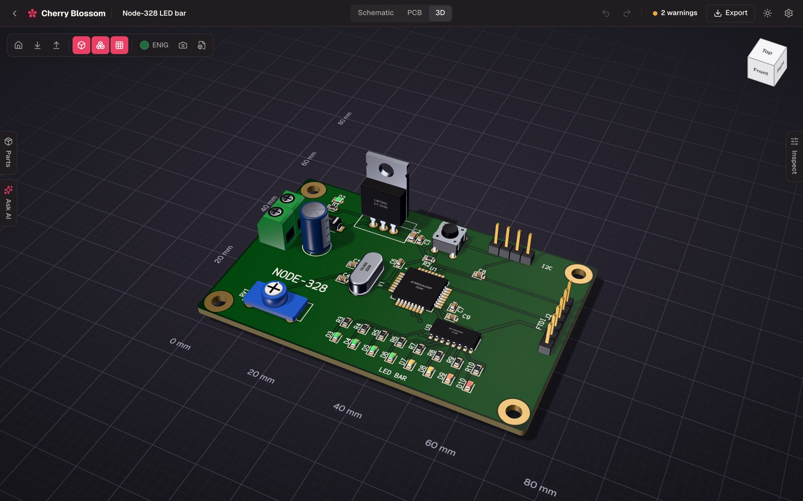
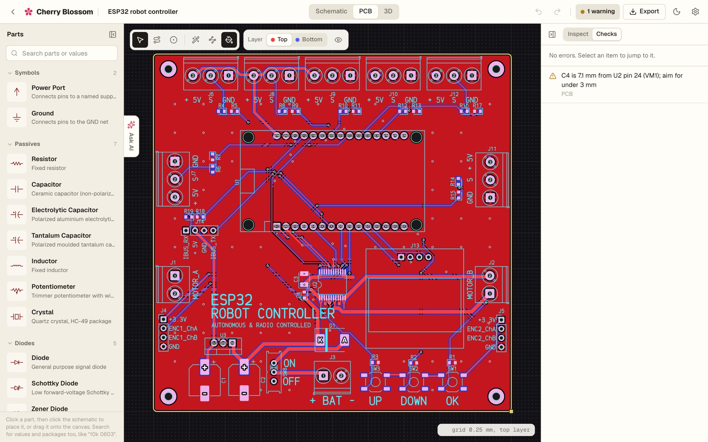
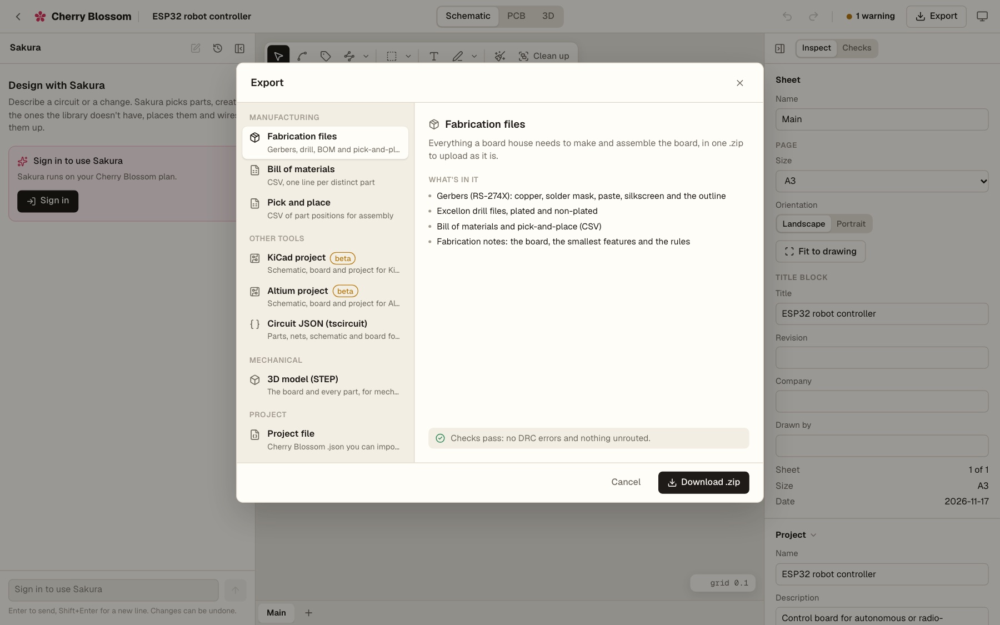
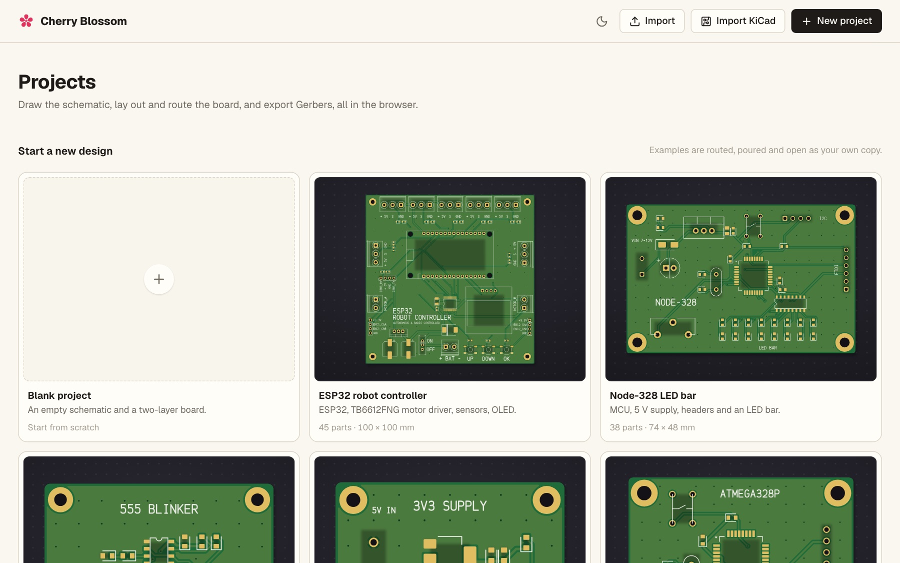

<p align="center">
  <a href="https://www.trycherryblossom.com">
    
  </a>
</p>

<h1 align="center">Cherry Blossom</h1>

<p align="center">
  <b>Build PCBs with AI, in an open-source editor that runs in your browser.</b><br>
  Describe a board to Claude, ChatGPT, Cursor, Codex or Sakura, our copilot: it picks real parts,<br>
  draws the schematic, lays out and routes the board, and checks its own work.<br>
  Then take it from there by hand, and export Gerbers, KiCad, Altium and STEP.
</p>

<p align="center">
  
  
  
  
  
  
  
</p>

<p align="center">
  <a href="https://www.trycherryblossom.com/app"><b>Open the hosted app</b></a> ·
  <a href="https://www.trycherryblossom.com/docs/mcp"><b>Connect your AI</b></a> ·
  <a href="https://www.trycherryblossom.com">trycherryblossom.com</a> ·
  <a href="https://github.com/cherryblossomhq/webapp/issues">Report a bug</a>
</p>

<br>

<p align="center">
  
  <br>
  <sub>The ESP32 robot controller example in the 3D view: 45 parts, routed and poured, with one decoupling warning in Checks.</sub>
</p>

> [!NOTE]
> **This is the editor behind [trycherryblossom.com](https://www.trycherryblossom.com), and the tools AI designs with in it.**
> Every action an AI takes on a board, from finding a part to routing the PCB,
> is a tool in this repository ([`src/ai`](src/ai)), run on the same document
> model and held to the same rules as your own edits. The hosted app connects
> the AI (your own assistant over MCP, or Sakura) and adds accounts, projects in
> the cloud that you share and edit together, version history, supplier part
> data and KiCad's 3D models. Everything in this repository, the whole editor
> by hand, runs locally with no backend.

<p align="center">
  <a href="#build-pcbs-with-ai">Build PCBs with AI</a> ·
  <a href="#features">Features</a> ·
  <a href="#everything-in-the-box">Everything in the box</a> ·
  <a href="#under-the-hood">Under the hood</a> ·
  <a href="#get-started">Get started</a> ·
  <a href="#contributing">Contributing</a> ·
  <a href="#license-and-credits">License</a>
</p>

<br>

<table>
  <tr>
    <td width="25%" valign="top">
      <h3>🤖 Built for AI</h3>
      Describe a board and an AI picks real parts, wires the schematic, places and routes the PCB and runs the checks, with tools that refuse to short a net. Every step is an ordinary edit you can see, change or roll back.
    </td>
    <td width="25%" valign="top">
      <h3>📐 Drawn like a sheet</h3>
      KiCad's proportions on a 50 mil grid, named blocks, net labels and power ports. Tidy redraws a messy sheet as an engineering drawing in one keystroke, without changing what's connected.
    </td>
    <td width="25%" valign="top">
      <h3>⚡ Routed and checked</h3>
      Placement that knows a regulator's power stage, an autorouter with net classes, per-net widths and fine-pitch escapes, copper pours with thermals, and design rule and electrical checks before you order.
    </td>
    <td width="25%" valign="top">
      <h3>📦 KiCad in, fab files out</h3>
      Import a KiCad project, board or schematic. Export Gerbers, drill, BOM and pick-and-place in one zip, or take the board elsewhere: KiCad, Altium, Circuit JSON and STEP.
    </td>
  </tr>
</table>

<br>

## Build PCBs with AI

Cherry Blossom is an editor made for AI to design in, not a chat box bolted onto
one. The schematic, the board and the checks are one typed model, and every
action an AI can take is a tool with rules it can't break: it can't short two
nets, cut a pin loose or guess a pinout without saying so. When it tries, the
tool refuses with a sentence saying why, and the AI tries again. What you get
back is an ordinary project: a schematic you can read, a board you can edit,
and files a fab will take.

There are two ways to bring the AI:

<table>
  <tr>
    <td width="50%" valign="top">
      <h3>🔌 Your own AI, over MCP</h3>
      <b>Claude, ChatGPT, Claude Code, Codex, Cursor</b> or any MCP client gets Sakura's tools on your projects, through the hosted app's MCP server. It runs on the AI subscription you already pay for, so it's <b>free on every plan</b>, Free included.
      <br><br>
      Its edits land live in any editor tab that has the project open, like a collaborator's, so you can watch the board come together.
      <br><br>
      <a href="https://www.trycherryblossom.com/docs/mcp"><b>Setup guide →</b></a>
    </td>
    <td width="50%" valign="top">
      <h3>🌸 Sakura, the copilot in the editor</h3>
      Nothing to install or connect: open a project and ask. Sakura searches the web and reads datasheets, builds the parts the library doesn't have from supplier data, wires and tidies the sheet, places and routes the board, runs the checks and looks at its own work before it reports.
      <br><br>
      Every change it makes can be undone like your own, and your chats are kept with each project. Included from the <b>Pro</b> plan.
      <br><br>
      <a href="https://www.trycherryblossom.com/app"><b>Open the app →</b></a>
    </td>
  </tr>
</table>

### Connect your AI in a minute

**Claude Code, Codex and Cursor:** the [Cherry Blossom plugin](https://github.com/cherryblossomhq/skills)
adds the MCP server and skills that teach your agent how to work in Cherry Blossom.

```bash
# Claude Code: then run /mcp in Claude Code to sign in
claude plugin marketplace add cherryblossomhq/skills
claude plugin install cherryblossom@cherryblossom

# Codex: it opens the sign-in in your browser
codex plugin marketplace add cherryblossomhq/skills
codex plugin add cherryblossom@cherryblossom

# Cursor: then Developer: Reload Window, and sign in from Cursor's MCP settings
git clone https://github.com/cherryblossomhq/skills ~/.cursor/plugins/local/cherryblossom
```

**Claude, ChatGPT and any other MCP client:** add this URL as a custom
connector (a remote MCP server, Streamable HTTP, with OAuth sign-in). Your
assistant opens Cherry Blossom's sign-in; sign in and allow it. There is no API
key to make or paste.

```text
https://www.trycherryblossom.com/api/mcp
```

The [setup guide](https://www.trycherryblossom.com/docs/mcp) has every client's
steps. Then ask:

> Make a new Cherry Blossom project for a 555 LED blinker, lay out and route the board, and check it.

> Export the Gerbers for my LED blinker.

### What the AI can do

- **Start from a sentence.** Create a project, find real parts by value, package
  or part number, read their datasheets, and build any part the library doesn't
  have from supplier data, its pins and land pattern checked against the
  supplier's (`find_part`, `search_parts`, `read_datasheet`, `create_part`).
- **Draw the schematic.** Place parts, connect pins and name nets, group a
  circuit into blocks, and tidy the sheet into a drawing an engineer can read,
  across hierarchical sheets (`add_component`, `connect`, `group_parts`,
  `tidy_schematic`).
- **Lay out and route the board.** Set the outline and the stackup, place parts
  by what they do (each decoupling capacitor at the pin it serves), size traces
  for their current, autoroute, pour ground, and draw a trace by hand where it
  matters (`set_board`, `layout_pcb`, `set_net_width`, `route_pcb`, `set_pour`,
  `draw_trace`).
- **Check its own work.** Run the design rule and electrical checks, and `look`
  at the schematic or the board: a picture with the numbers behind it
  (overlaps, wires through symbols, unconnected pins, parts off the board,
  unrouted connections), so it fixes what it sees before it reports.
- **Save and go back.** Name a version before a big change and restore it if
  the change goes wrong (`save_version`, `restore_version`).
- **Hand you the files.** Fabrication files, the BOM and pick-and-place, a KiCad
  or Altium project with its 3D models, a STEP model or the project file, as a
  download link (`export_files`, over MCP).

### Why the boards come out right

- **Nets are sacred.** Every tool call is checked against the netlist. An edit
  that would join two nets nobody asked to join, or leave a pin loose, is
  refused with the pins and nets named, and changes nothing
  ([`src/model/merges.ts`](src/model/merges.ts)).
- **Real parts, not remembered ones.** Parts come from supplier data when a
  supplier has them; a part made from memory is marked unverified, and the
  checks say so.
- **It sees what it made.** `look` draws the sheet or the board as you see it,
  and the checks point at each problem by part, pin and place.
- **One design guide for every AI.** Sakura's prompt and the MCP server's
  instructions are built from the same guide
  ([`src/ai/designGuide.ts`](src/ai/designGuide.ts)): how to group a circuit,
  decouple a chip, wire a block a reader can follow, and route a board, so your
  own assistant designs by the same rules as Sakura.
- **Its edits are your edits.** The same document model and the same rules as
  your own. Sakura's steps are on your undo stack; your own assistant's land
  live like a collaborator's, and it saves a version before a big change that
  you can go back to. Nothing the AI makes is a black box you have to accept or
  throw away.

Sakura's tools, agent loop and design guide are in this repository
([`src/ai`](src/ai)) and run in the browser; the models, the MCP server and the
supplier data they call are the hosted app's. A local build has no session, so
its Sakura panel offers to sign in at the hosted app instead of calling
anything.

## Features

Every screenshot here is the editor as it runs from this repository, on its shipped examples.

<table>
  <tr>
    <td width="50%" valign="top">
      
      <br>
      <sub>A schematic grouped into blocks, on the classic cream EDA sheet.</sub>
      <h3>A schematic that reads like one</h3>
      Orthogonal wires, net labels that sit side by side on neighbouring pins, junction dots, and parts that rubber-band their wires when they move. Group parts into named blocks (<code>⌘G</code>) and the frames follow them.
      <br><br>
      <b>Tidy</b> (<code>T</code>) lays the sheet out again by signal flow: supply in, regulation, the controller, what it talks to. <b>Clean up</b> groups loose parts into blocks by how they're wired first. Both are one undo step, and both are checked pin for pin against the netlist.
    </td>
    <td width="50%" valign="top">
      
      <br>
      <sub>Two layers, routed and poured, with designators placed clear of the pads.</sub>
      <h3>Layout that does the tedious part</h3>
      Auto-placement puts each decoupling capacitor beside the pin it serves, and a regulator's capacitors, inductor and feedback divider at its pins. The autorouter runs A* on every copper layer with vias, net-aware clearances, KiCad's hole clearance and per-net trace widths, takes up and re-lays what blocks a connection it left open, and keeps the copper you routed by hand.
      <br><br>
      Interactive routing with 45° bends, arcs and vias, traces reshaped by dragging their segments and corners, up to 32 copper layers with blind and buried vias, bottom-side parts, any board outline, mounting holes, text in KiCad's own font, dimensions, and pours and zones with thermal spokes and stitching vias.
      <br><br>
      The layer you work on is drawn in front, the others softer, dimmed or hidden (<code>⇧S</code>), and pours filled, outlined or off. Double-click where tracks, pads and silkscreen overlap and pick the one you meant from a list, as Altium does.
    </td>
  </tr>
  <tr>
    <td width="50%" valign="top">
      
      <br>
      <sub>Here a part shows its pads until it has a model; the hosted app draws KiCad's.</sub>
      <h3>See it before it's made</h3>
      The board in 3D with glossy mask, plated holes, tented or open vias and your choice of finish, mask and silkscreen colour. Parts are drawn only with real models, never made-up bodies.
      <br><br>
      Drop in a model (STEP, OBJ, WRL, STL or GLB) for any part. STEP files are read by OpenCascade in a Web Worker, so nothing leaves your machine. The hosted app also draws KiCad's 3D library and the supplier's models.
    </td>
    <td width="50%" valign="top">
      
      <br>
      <sub>A decoupling capacitor too far from the pin it serves, found and pointed at.</sub>
      <h3>Checks that know electronics</h3>
      Design rule checks for trace width, clearance, drill, annular ring, hole to hole, copper to edge and vias in pads, with fab capability classes that set a fab's limits in one step.
      <br><br>
      Electrical checks too: an LED with no series resistor, a two-pin part shorted to itself, a label no other pin has. Click one to select the culprit, or ignore a false alarm for good.
    </td>
  </tr>
  <tr>
    <td width="50%" valign="top">
      
      <br>
      <sub>Everything a fab, an assembler or another tool needs, and what the board still lacks, before you download.</sub>
      <h3>Take it anywhere</h3>
      RS-274X Gerbers with pours, mask and paste, Excellon drill with slots, a BOM, pick-and-place and fabrication notes, zipped. A KiCad 9 project with the rules and net classes carried over, an Altium Designer project (beta), each with the parts' 3D models, Circuit JSON for tscircuit, and the whole board as a STEP assembly for mechanical CAD. The Export dialog says what each file holds and what the board still needs before it's made.
      <br><br>
      <b>KiCad in, too.</b> A KiCad project, board or schematic imports with its sheets, buses, zones, net classes and rules (KiCad 6 and later, and the schematics of KiCad 4 and 5). What the editor can't hold yet is named in a report, never dropped quietly, and the original files are kept with the project.
    </td>
    <td width="50%" valign="top">
      
      <br>
      <sub>Five routed examples to start from, each opening as your own copy.</sub>
      <h3>Yours, in your browser</h3>
      Projects save as you work, in your browser, and download as a single versioned file you can open anywhere. Older files are migrated when they open, and a file from a newer version is refused rather than damaged.
      <br><br>
      Open a project in two tabs and each sees the other's edits, cursor and selection, and undo takes back only your own: the same live editing the hosted app runs between people.
      <br><br>
      Light and dark themes, shortcuts for every tool, and undo for every change.
    </td>
  </tr>
</table>

<br>

## Everything in the box

<table>
  <tr>
    <td width="33%" valign="top">
      <h4>🧰 Parts</h4>
      Basic parts built in: resistors, capacitors (ceramic, electrolytic, tantalum), inductors, potentiometers, crystals, diodes, LEDs, BJTs and MOSFETs, power and ground ports, a battery and coin-cell holder, switches, a relay and a buzzer.
      <br><br>
      Everything else is a part of the project: imported from a KiCad symbol, footprint and 3D model, or drawn in the part editor. Search understands values and packages: <code>10k 0603</code> places a 10k 0603 resistor.
    </td>
    <td width="33%" valign="top">
      <h4>✏️ Schematic</h4>
      Wires · net labels · global labels and ports · power and ground ports · junctions · no-connect flags · blocks · hierarchical sheets with entries drawn by hand · pages with a border, zones and a title block that fills itself in · buses · variants · text, lines, arrows, polygons and rectangles for titles and notes · copy, paste and duplicate · Tidy · Clean up · rotate, flip and drag with nets kept intact.
      <h4>🟥 PCB</h4>
      Auto-place · re-pack · autoroute on every layer · interactive routing · trace reshaping · arcs · vias · up to 32 copper layers · net classes · per-net widths · copper pours and zones · keepouts · thermal spokes · stitching vias · locked parts and copper · any board outline, cutouts, mounting holes · dimensions · reference images · other layers shown, dimmed or hidden · a pick list where things overlap · designators moved, hidden or reset · stackup, copper weight, finish, mask and silkscreen colours design rules in mm or mil.
    </td>
    <td width="33%" valign="top">
      <h4>📤 Exports</h4>
      Gerber RS-274X · Excellon drill · BOM CSV · pick-and-place CSV · fabrication notes · KiCad 9 project with 3D models · Altium Designer project with 3D models (beta) · Circuit JSON · STEP AP214 assembly · PNG from the 3D view · the project file.
      <h4>⌨️ Shortcuts</h4>
      Schematic: <code>W</code> wire · <code>L</code> label · <code>B</code> block · <code>R</code> rotate · <code>T</code> tidy · <code>⌘G</code> group.<br>
      PCB: <code>W</code> route · <code>V</code> via · <code>L</code> layer · <code>F</code> flip · <code>⇧S</code> other layers.<br>
      Both: <code>⌘Z</code> undo · <code>[</code> <code>]</code> panels. The full list is in <a href="AGENTS.md#shortcuts">AGENTS.md</a>.
    </td>
  </tr>
</table>

<br>

## Under the hood

- **Its own document model.** A typed ECAD project edited by pure functions, with
  no compile step between what you draw and what's on screen. Connectivity, checks
  and exports all read the same model.
- **Nets are sacred.** Every move, turn, paste, drag and Tidy is checked against the
  netlist; an edit that would short two nets or cut a pin loose is refused, with
  a sentence saying why, and changes nothing.
- **Fast where it matters.** Spatial indexes, memoised analysis,
  Tidy and STEP reading in Web Workers, and the 3D view and KiCad converter loaded
  only when you ask for them.
- **A real file format.** Versioned, migrated on read, and tolerant of fields it
  doesn't know, which survive a save.
- **Edits travel as changes.** Every edit is written as a list of changes to the
  project's items (`host/project-changes.ts`), applied the same way by every open
  copy, so two people, or two tabs, edit one project without overwriting each other.
- **Tested hard.** More than 5,000 unit tests, including fuzzers that throw random
  edits at random sheets, round trips through Circuit JSON and KiCad, STEP and
  KiCad exports read back and checked, and corpus tests that import some 1,500
  open-source KiCad boards when you point them at a copy (`npm run test:corpus`);
  plus a Playwright suite that drives the editor in a real browser.

## Get started

Requires **Node 24** (see [`.nvmrc`](.nvmrc)).

```bash
git clone https://github.com/cherryblossomhq/webapp
cd webapp
npm install
npm run dev          # http://localhost:5173
```

No environment variables, no API keys, no services to provision.

```bash
npm run check        # typecheck, unit tests and a production build
npm run test:e2e     # the browser suite (run npm run test:e2e:install once first)
npm run build        # a static site in dist/
```

The build is a static single-page app: host `dist/` anywhere, with every path
falling back to `index.html` so a link to a project (`/p/<id>`) opens it.

New contributors and AI agents: start with [`AGENTS.md`](AGENTS.md). It covers the
architecture, the file format, how Tidy and the router work, and the sharp edges.

> [!IMPORTANT]
> **Early stage.** The schematic and PCB editors work end to end and the examples
> go all the way to Gerbers, but expect rough edges and breaking changes. The
> autorouter can leave a dense board's last connections to you, and there is no
> simulation yet. Please file issues with the steps, your browser,
> and a project file if you can share one.

## Contributing

**We're not looking for pull requests right now.** The project is early enough
that the architecture is still moving under our feet, and a PR you spend real
time on may sit unreviewed or get closed because it collides with something
we're already rewriting. We'd rather say that up front than waste your evening.

Bug reports are genuinely useful: [open an issue](https://github.com/cherryblossomhq/webapp/issues).
Found a security problem? Please don't file it publicly; contact a maintainer directly.

---

## License and credits

[AGPL-3.0-or-later](LICENSE). Use it commercially, modify it, redistribute it,
build a business on it. The one obligation: if you distribute a modified
version, or run one as a network service others use, those users get the
complete source of your version under this same license.

Designing boards with the editor — including boards you sell — carries no
obligation at all. This governs the editor's source, not your circuits.

Third-party components keep their own licenses; see
[THIRD-PARTY-NOTICES.md](THIRD-PARTY-NOTICES.md). "Cherry Blossom" and the
cherry blossom logo are trademarks and are not licensed — please rename and
re-brand forks.

<sub>KiCad, Altium and other product names are trademarks of their respective owners. Cherry Blossom is an independent project, not affiliated with or endorsed by them; the names are used only to describe compatible workflows and file formats.</sub>

<p align="center">
  <a href="https://www.trycherryblossom.com"></a><br>
  <sub>Made with 🌸 for the hardware community.</sub>
</p>

## Star history

[](https://www.star-history.com/#cherryblossomhq/webapp&Date)
